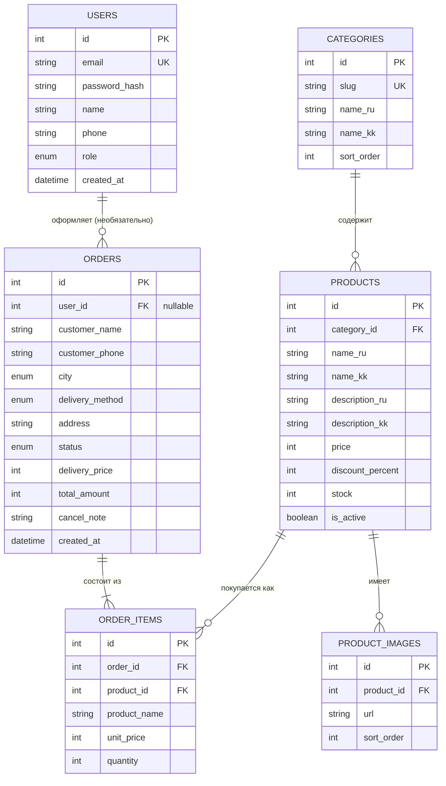
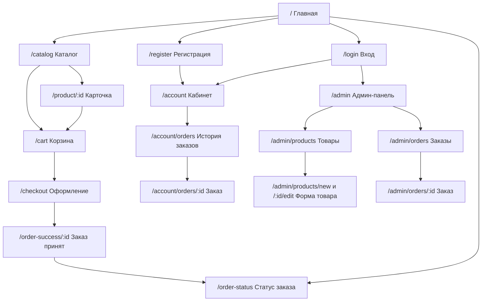

# Архитектура: tvoribox — веб-платформа заказов наборов для творчества

**Стек:** React (Vite) + Node.js + Express + PostgreSQL + Prisma
**Тип проекта:** учебный, один разработчик, сначала локальный запуск, затем хостинг
**Языки сайта:** русский и казахский
**Запуск проекта:** см. `README.md` в корне репозитория

## 0. Кратко о проекте

Интернет-магазин одного продавца. Покупатели — родители, дети, школьники, учителя и взрослые, увлекающиеся рукоделием. Можно смотреть каталог (50–100 товаров, 9 категорий), класть товары в корзину и оформлять заказ с доставкой курьером (Алматы, Астана) или самовывозом (только Алматы). Заказ можно сделать без регистрации; статус заказа гость узнаёт по номеру и телефону. Оплата — при получении. Один администратор управляет товарами, ценами, скидками и заказами.

Проблема, которую решает сайт: покупателю не нужно звонить или писать в мессенджер, чтобы узнать наличие и цену; продавцу не нужно вести заказы в тетради.

### Принятые решения по ответам

| Тема | Решение | Почему так |
|---|---|---|
| Корзина | Хранится в браузере (localStorage), сервер проверяет её при оформлении | Проще для старта; гостю не нужна запись в БД. Если хранить корзину только в браузере и верить ей, цены можно подделать, поэтому сервер пересчитывает всё сам |
| Избранное | Не входит в MVP, добавится после первой версии (см. раздел 10) | Оно не нужно для покупки. Сначала нужно довести до конца путь «каталог → корзина → заказ» |
| Оплата | В MVP — **только при получении** (наличными или переводом курьеру / в точке самовывоза). Онлайн-оплата картой — позже (раздел 10.1). **Данные карты на нашем сервере не хранятся никогда** | Реальный платёж требует договора с провайдером, подтверждений платежа и много тестов. А номер карты — самые опасные данные: если сайт их хранит и его взломают, будут проблемы по закону и у покупателей |
| Языки | Русский и казахский, тексты товаров хранятся в двух колонках (`name_ru`, `name_kk`) | Проще таблицы и запросы, чем отдельная таблица переводов. Минус: третий язык потребует миграции (изменения таблиц) |
| Цены | Целые числа в тенге, без копеек | Дробные числа в вычислениях дают ошибки округления (0.1 + 0.2 ≠ 0.3), а в тенге копейки не нужны |
| Удаление товара | «Мягкое»: товар скрывается (`is_active = false`), а не стирается | Если стереть товар, который уже купили, сломается история заказов |
| Доставка | Курьер — в Алматы и Астану, цена зависит от города и хранится в `.env`; от определённой суммы бесплатно. Самовывоз — только в Алматы. Подробно — в разделе 4 | Продавец один, точка выдачи одна. Правила стоимости записаны, чтобы сумма заказа не зависела от «как договоримся» |
| Скидка и округление | Скидка 0–90 %, цена со скидкой округляется вниз до целого тенге, считает сервер | Цены целые, а проценты дают дроби; правило должно быть одно на весь сайт |

---

## 1. Пользователи и роли

| Роль | Кто это | Что может | Чего не может |
|---|---|---|---|
| **Гость** | Любой, кто зашёл на сайт без входа | Смотреть каталог и карточки, искать, фильтровать по категории, пользоваться корзиной, переключать язык, оформить заказ (имя + телефон), узнать статус заказа по номеру и телефону, зарегистрироваться, войти | Добавлять товары в избранное |
| **Клиент** (CUSTOMER) | Зарегистрированный покупатель | Всё, что гость, плюс: личный кабинет, история своих заказов, автозаполнение имени и телефона при заказе | Управлять аккаунтами других пользователей |
| **Администратор** (ADMIN) | Владелец магазина (один) | Добавлять, редактировать, скрывать товары; загружать фото; менять цены, скидки, остатки; смотреть все заказы и менять их статус | — |

*Почему так:* роль хранится в таблице пользователей и проверяется **на сервере**. Если проверять роль только на странице (прятать кнопку «Админка»), любой человек отправит запрос вручную и удалит товары.

---

## 2. MVP — минимальная первая версия

### Что входит (7 функций)

1. **Каталог** на двух языках (RU/KK): список товаров, 9 категорий, поиск по названию, цена со скидкой.
2. **Карточка товара**: фото, описание, цена, остаток.
3. **Корзина**: добавить, удалить, изменить количество, итоговая сумма.
4. **Оформление заказа** для гостя и клиента: имя, телефон, доставка (курьер или самовывоз), город (Алматы или Астана), адрес для курьера. Стоимость доставки считает сервер, оплата — картой. Гость узнаёт статус заказа по номеру и телефону.
5. **Регистрация, вход, личный кабинет** с историей заказов.
6. **Админка товаров**: создание, редактирование, скрытие, загрузка фото, цена, скидка, остаток.
7. **Админка заказов**: список всех заказов и смена статуса.

*Почему так:* это минимальный набор, при котором магазин реально работает от просмотра до выдачи заказа. Всё остальное можно добавить, не ломая эти 7 функций.

### Что НЕ входит в первую версию

| Не входит | Почему |
|---|---|
| Онлайн-оплата картой (и поля `payment_method`, `payment_status`) | Нужен договор с платёжным провайдером, подтверждения платежей (webhook — провайдер сам присылает серверу сообщение «деньги пришли»), много тестов. В MVP — только оплата при получении; таблица `payments` и поля оплаты добавятся в разделе 10.1 |
| Избранное | Для первой покупки не нужно: добавить в корзину и оформить заказ можно и без него. Таблица и API описаны в разделе 10 |
| Отзывы и рейтинг | Нужна модерация (проверка отзывов), это отдельная функция |
| Промокоды | Скидка на товар уже есть, промокоды усложняют расчёт суммы |
| Письма и SMS-уведомления | Нужны сторонние сервисы, лишняя сложность для старта |
| Восстановление пароля по email | Нужна отправка писем |
| Отмена заказа клиентом | Требует правил возврата остатка; в MVP отменяет администратор |
| Корзина в БД (синхронизация между устройствами) | Достаточно корзины в браузере |
| Управление категориями из админки | Категорий 9, они фиксированы, добавляются заранее скриптом заполнения (seed) |

---

## 3. Пользовательские истории

| № | История | MVP |
|---|---|---|
| US1 | Как **гость**, я хочу смотреть каталог по категориям, чтобы найти нужные товары | Да |
| US2 | Как **гость**, я хочу искать товары по названию, чтобы быстро найти конкретный набор | Да |
| US3 | Как **гость**, я хочу открыть карточку товара с фото и описанием, чтобы понять, что я покупаю | Да |
| US4 | Как **гость**, я хочу переключить язык (RU/KK), чтобы читать сайт на удобном языке | Да |
| US5 | Как **гость**, я хочу добавить товары в корзину и изменить количество, чтобы собрать заказ | Да |
| US6 | Как **гость**, я хочу оформить заказ, указав только имя и телефон, чтобы не тратить время на регистрацию | Да |
| US7 | Как **гость**, я хочу зарегистрироваться, чтобы видеть историю заказов | Да |
| US8 | Как **клиент**, я хочу войти в аккаунт, чтобы пользоваться личным кабинетом | Да |
| US9 | Как **клиент**, я хочу видеть историю только своих заказов, чтобы знать статус и состав | Да |
| US10 | Как **клиент**, я хочу добавлять товары в избранное и удалять их оттуда, чтобы вернуться к ним позже | Нет (после MVP) |
| US11 | Как **администратор**, я хочу добавлять и редактировать товары с фото, ценой, скидкой и остатком, чтобы витрина была актуальной | Да |
| US12 | Как **администратор**, я хочу скрывать товар, чтобы он не показывался, но история заказов сохранилась | Да |
| US13 | Как **администратор**, я хочу видеть все заказы и менять их статус, чтобы вести заказ от «новый» до «выдан» | Да |
| US14 | Как **клиент**, я хочу оплатить заказ картой онлайн, чтобы не платить при получении | Нет (после MVP) |
| US15 | Как **клиент**, я хочу оставить отзыв на товар, чтобы помочь другим покупателям | Нет (после MVP) |
| US16 | Как **гость**, я хочу узнать статус заказа по номеру и телефону, чтобы не звонить продавцу | Да |

---

## 4. Бизнес-правила

Это правила, которые **сервер проверяет всегда**. Браузер — чужая территория: человек может открыть консоль, изменить код страницы или отправить запрос в обход сайта.

| № | Правило | Почему нельзя проверять только в браузере |
|---|---|---|
| R1 | **Цену и сумму заказа считает сервер** по ценам из БД. Цены из браузера игнорируются | Иначе можно отправить заказ с ценой 1 тенге |
| R2 | Нельзя заказать больше, чем есть на складе. Остаток списывается в момент заказа одной транзакцией (операции «всё или ничего») | Два человека одновременно купят последний товар; браузер этого не видит |
| R3 | Клиент видит **только свои** заказы | Иначе, подставив чужой номер заказа в адрес, можно прочитать чужие имя, телефон и адрес |
| R4 | Товары, цены, скидки и статусы заказов меняет только администратор | Кнопку в браузере можно спрятать, но запрос всё равно можно отправить вручную |
| R5 | Цена больше 0, скидка от 0 до 90, остаток не меньше 0 | Браузерная проверка обходится одной строчкой в консоли. Скидка 100 % сделала бы товар бесплатным |
| R6 | Нельзя заказать скрытый (неактивный) товар | Товар мог быть скрыт после того, как лежал в корзине |
| R7 | Доставка только в Алматы и Астану. Курьер — в оба города, адрес обязателен. Самовывоз — только в Алматы (там точка выдачи), адрес не нужен. В Астане — только курьер | Иначе в БД попадут заказы, которые нельзя выполнить |
| R8 | Телефон: сервер сам приводит любой привычный ввод (`8 701…`, `+7 (701)…`, `7701…`) к виду `+7XXXXXXXXXX` (10 цифр после +7) и только потом сохраняет. Имя не пустое, количество — целое число от 1 | Мусорные данные ломают работу с заказами и поиск заказа по телефону |
| R9 | Email уникален, пароль минимум 8 символов | Уникальность нельзя доверять браузеру: две вкладки зарегистрируют один email |
| R10 | Статус заказа меняется только по цепочке. **Курьер:** NEW → CONFIRMED → IN_DELIVERY → COMPLETED. **Самовывоз:** NEW → CONFIRMED → READY_FOR_PICKUP → COMPLETED. Отмена (CANCELLED) — из NEW, CONFIRMED, READY_FOR_PICKUP. Из IN_DELIVERY — только с обязательной пометкой «возврат» (`cancel_note`), когда товар вернулся. Из COMPLETED отменить нельзя. При отмене остаток товара возвращается | Иначе завершённый заказ можно «оживить» и остатки сломаются; товар, который у курьера, нельзя «вернуть на склад» только в программе |
| R11 | Заказ не может быть пустым | Запрос можно отправить без товаров |
| R12 | Данные банковской карты не принимаются и не хранятся сервером | Это защита покупателей и вас |
| R13 | Цена со скидкой = `floor(price × (100 − discount_percent) / 100)` — округление вниз до целого тенге. Считается только на сервере | Иначе браузер и сервер получат разные суммы |
| R14 | Стоимость доставки: самовывоз — 0; курьер — цена по городу (Алматы / Астана) из `.env`; если сумма товаров не меньше порога бесплатной доставки — 0. `total_amount = товары + доставка`, `delivery_price` сохраняется в заказе | Иначе цена курьера «зависит от настроения», а изменение тарифа испортит старые заказы |
| R15 | Оплата в MVP — только при получении (наличными или переводом). Полей оплаты в заказе нет | Без реального платежа статус «оплачен» ничего не значит |
| R16 | Страница «Заказ принят» показывает только то, что вернул `POST /api/orders`, и **не загружает заказ по номеру из адреса**. Гость смотрит статус через `POST /api/orders/track` (номер + телефон) | Иначе, подставив 40, 39, 38…, можно увидеть чужие имена, телефоны и адреса |

### Как считается сумма заказа

Всё считает сервер (R1, R13, R14). Значения тарифов — **примеры, замените реальными** (они хранятся в `server/.env`):

| Параметр | Пример | Переменная |
|---|---|---|
| Курьер, Алматы | 1 500 ₸ | `DELIVERY_PRICE_ALMATY` |
| Курьер, Астана | 3 000 ₸ | `DELIVERY_PRICE_ASTANA` |
| Бесплатная доставка от суммы товаров | 20 000 ₸ | `FREE_DELIVERY_FROM` |
| Адрес самовывоза (Алматы) | указать | `PICKUP_ADDRESS_ALMATY` |

Пример: набор 3 333 ₸ со скидкой 15 % → 3 333 × 85 / 100 = 2 833,05 → **2 833 ₸** (вниз). Два таких набора = 5 666 ₸, курьер по Алматы +1 500 ₸, `total_amount` = **7 166 ₸**. Самовывоз: 5 666 ₸.

### Что такое транзакция и зачем она для остатков

**Транзакция** — это группа действий с базой данных, которая выполняется по принципу «всё или ничего»: либо прошли все действия, либо не прошло ни одно.

Оформление заказа — это несколько действий подряд:
1. проверить, что товара хватает;
2. уменьшить остаток;
3. создать заказ и его состав.

**Проблема 1: сбой посередине.** Остаток уже уменьшили, а на шаге 3 произошла ошибка. Товар исчез со склада, а заказа нет. Транзакция при ошибке откатывает всё назад, как будто ничего не было.

**Проблема 2: два покупателя одновременно.** На складе 1 штука. Оба покупателя проверили остаток, оба увидели «1 есть», оба купили. Остаток стал -1, один заказ невыполним. В транзакции остаток уменьшается только при условии «остаток не меньше нужного количества»: второй покупатель получит ответ «товара недостаточно».

*Почему так:* без транзакции остатки на сайте со временем перестанут совпадать с реальным складом. В Prisma для этого есть `prisma.$transaction`; всю работу с остатком делаем только в `orderService`, внутри транзакции.

---

## 5. База данных (PostgreSQL + Prisma)

### 5.1 Таблицы

Типы: `Int` — целое число, `String` — текст, `Boolean` — да/нет, `DateTime` — дата и время, `enum` — выбор из фиксированного списка.

**users** — пользователи (клиенты и админ)

| Поле | Тип | Примечание |
|---|---|---|
| id | Int | первичный ключ (PK, уникальный номер строки) |
| email | String | уникальный |
| password_hash | String | хеш пароля (результат необратимого шифрования), не сам пароль |
| name | String | |
| phone | String | обязательное, формат `+7XXXXXXXXXX` (нужно для заказов и автозаполнения) |
| role | enum | CUSTOMER или ADMIN |
| created_at | DateTime | |

**categories** — категории

| Поле | Тип | Примечание |
|---|---|---|
| id | Int | PK |
| slug | String | уникальный адрес, например `foamiran` |
| name_ru | String | |
| name_kk | String | |
| sort_order | Int | порядок в меню |

**products** — товары

| Поле | Тип | Примечание |
|---|---|---|
| id | Int | PK |
| category_id | Int | внешний ключ (FK, ссылка на categories.id) |
| name_ru, name_kk | String | |
| description_ru, description_kk | String | |
| price | Int | цена в тенге без скидки |
| discount_percent | Int | 0–90, по умолчанию 0 |
| stock | Int | остаток |
| is_active | Boolean | false = скрыт |
| created_at, updated_at | DateTime | |

**product_images** — фото товара

| Поле | Тип | Примечание |
|---|---|---|
| id | Int | PK |
| product_id | Int | FK → products.id |
| url | String | путь к файлу, сами файлы лежат в папке на сервере, не в БД |
| sort_order | Int | 0 = главное фото |

**orders** — заказы

| Поле | Тип | Примечание |
|---|---|---|
| id | Int | PK |
| user_id | Int, необязательное | FK → users.id; пусто, если заказ от гостя |
| customer_name | String | копия имени на момент заказа |
| customer_phone | String | в формате `+7XXXXXXXXXX` (сервер приводит сам) |
| city | enum | ALMATY или ASTANA (PICKUP — только для ALMATY) |
| delivery_method | enum | COURIER или PICKUP |
| address | String, необязательное | только для курьера |
| status | enum | NEW, CONFIRMED, IN_DELIVERY, READY_FOR_PICKUP, COMPLETED, CANCELLED |
| delivery_price | Int | стоимость доставки на момент заказа (0 для самовывоза и бесплатной доставки) |
| total_amount | Int | товары + доставка, посчитано сервером |
| cancel_note | String, необязательное | причина отмены; при отмене из IN_DELIVERY обязательно («возврат») |
| comment | String, необязательное | |
| created_at | DateTime | |

**order_items** — состав заказа

| Поле | Тип | Примечание |
|---|---|---|
| id | Int | PK |
| order_id | Int | FK → orders.id |
| product_id | Int | FK → products.id |
| product_name | String | название товара на момент покупки |
| unit_price | Int | цена за штуку с учётом скидки на момент покупки |
| quantity | Int | |

*Почему так (копии в заказе):* если администратор завтра поменяет цену или название, старые заказы должны показывать то, что реально купили. Без копий история заказов будет «врать».

### 5.2 Связи

| Связь | Тип | Как реализована |
|---|---|---|
| categories → products | один-ко-многим (в категории много товаров) | `products.category_id` |
| products → product_images | один-ко-многим | `product_images.product_id` |
| users → orders | один-ко-многим (у клиента много заказов; гость — без пользователя) | `orders.user_id`, может быть пустым |
| orders → order_items | один-ко-многим | `order_items.order_id` |
| **orders ↔ products** | **многие-ко-многим** | таблица-связка `order_items` (в ней ещё количество и цена) |

### 5.3 ER-диаграмма



### 5.4 Проверка архитектуры БД

**Дублирование данных.** Осознанные копии: `orders.customer_name/phone` (у гостя нет записи в users, а у клиента данные могут измениться), `order_items.product_name/unit_price`, `orders.delivery_price` и `orders.total_amount` (фиксируют заказ на момент покупки). Больше дублей нет: категория хранится один раз и связана по `category_id`, фото не лежат внутри товара.

**Можно ли добавлять функции, не ломая таблицы.** Да: избранное, отзывы, промокоды, платежи, варианты товара — это новые таблицы, которые ссылаются на старые. Старые не меняются. Единственное узкое место — языки (см. раздел 10).

---

## 6. API

REST (адреса и методы запросов: GET — получить, POST — создать, PUT — заменить, PATCH — изменить часть, DELETE — удалить). Все адреса начинаются с `/api`. Ответы в формате JSON.

Доступ: **Все** = гость и выше; **Клиент** = вошедший; **Админ** = только администратор.

| № | Метод | Адрес | Что делает | Доступ | История | Пример запроса → ответ |
|---|---|---|---|---|---|---|
| 1 | GET | `/api/categories` | Список категорий | Все | US1 | — → `[{ "id": 1, "slug": "foamiran", "nameRu": "Фоамиран", "nameKk": "Фоамиран" }]` |
| 2 | GET | `/api/products` | Каталог с фильтром, поиском, страницами | Все | US1, US2, US4 | `?category=foamiran&search=цветы&page=1` → `{ "items": [{ "id": 5, "nameRu": "…", "nameKk": "…", "price": 4000, "finalPrice": 3200, "inStock": true, "image": "/uploads/5-1.jpg" }], "total": 12 }` |
| 3 | GET | `/api/products/:id` | Карточка товара | Все | US3 | `/api/products/5` → `{ "id": 5, "descriptionRu": "…", "price": 4000, "discountPercent": 20, "stock": 7, "images": ["…"] }` |
| 4 | POST | `/api/cart/price` | Пересчитывает корзину по актуальным ценам; если указаны город и способ доставки, добавляет стоимость доставки | Все | US5 | `{ "items": [{ "productId": 5, "quantity": 2 }], "city": "ALMATY", "deliveryMethod": "COURIER" }` → `{ "items": [{ "productId": 5, "unitPrice": 3200, "quantity": 2 }], "itemsTotal": 6400, "deliveryPrice": 1500, "total": 7900 }` |
| 5 | POST | `/api/auth/register` | Регистрация | Все | US7 | `{ "email": "a@b.kz", "password": "…", "name": "Айгуль", "phone": "+77001234567" }` → `{ "id": 3, "name": "Айгуль" }` |
| 6 | POST | `/api/auth/login` | Вход, выдаёт токен в cookie | Все | US8 | `{ "email": "…", "password": "…" }` → `{ "id": 3, "role": "CUSTOMER" }` |
| 7 | POST | `/api/auth/logout` | Выход | Клиент | US8 | — → `{ "ok": true }` |
| 8 | GET | `/api/auth/me` | Кто я (для шапки сайта) | Клиент | US8 | — → `{ "id": 3, "name": "Айгуль", "role": "CUSTOMER" }` |
| 9 | POST | `/api/orders` | Создаёт заказ (гость или клиент). Оплата при получении | Все | US6, US5 | `{ "customerName": "Дина", "customerPhone": "8 (701) 111-22-33", "city": "ALMATY", "deliveryMethod": "COURIER", "address": "ул. …", "items": [{ "productId": 5, "quantity": 2 }] }` → `{ "orderId": 41, "total": 7900, "deliveryPrice": 1500, "status": "NEW" }`; телефон сохранится как `+77011112233`; самовывоз в Астане → 400 |
| 10 | POST | `/api/orders/track` | Статус заказа для гостя: номер + телефон | Все | US16 | `{ "orderId": 41, "phone": "+7 701 111 22 33" }` → `{ "id": 41, "status": "NEW", "deliveryMethod": "COURIER", "deliveryPrice": 1500, "total": 7900, "items": [{ "productName": "…", "unitPrice": 3200, "quantity": 2 }] }`; номер или телефон не совпали → одинаковый 404 «Заказ не найден» (с ограничением числа попыток) |
| 11 | GET | `/api/orders/my` | Мои заказы | Клиент | US9 | — → `[{ "id": 41, "status": "NEW", "total": 7900, "createdAt": "…" }]` |
| 12 | GET | `/api/orders/my/:id` | Один мой заказ с составом | Клиент (только свой) | US9 | `/api/orders/my/41` → `{ "id": 41, "items": [{ "productName": "…", "unitPrice": 3200, "quantity": 2 }] }`; чужой заказ → 404 |
| 13 | POST | `/api/admin/products` | Создать товар | Админ | US11 | `{ "categoryId": 2, "nameRu": "…", "nameKk": "…", "price": 4000, "discountPercent": 0, "stock": 10 }` → `{ "id": 51 }` |
| 14 | PUT | `/api/admin/products/:id` | Изменить товар (цена, скидка, остаток, тексты) | Админ | US11 | `{ "price": 4500, "stock": 8, … }` → `{ "id": 51 }` |
| 15 | PATCH | `/api/admin/products/:id/visibility` | Скрыть или показать товар | Админ | US12 | `{ "isActive": false }` → `{ "id": 51, "isActive": false }` |
| 16 | POST | `/api/admin/products/:id/images` | Загрузить фото (multipart — форма с файлом) | Админ | US11 | файл `image` (jpg/png/webp) → `{ "id": 9, "url": "/uploads/51-1.jpg" }` |
| 17 | DELETE | `/api/admin/images/:id` | Удалить фото | Админ | US11 | `/api/admin/images/9` → `{ "ok": true }` |
| 18 | GET | `/api/admin/orders` | Все заказы с фильтром по статусу | Админ | US13 | `?status=NEW` → `[{ "id": 41, "customerName": "Дина", "total": 7900, "status": "NEW" }]` |
| 19 | PATCH | `/api/admin/orders/:id/status` | Сменить статус заказа (только по цепочке из R10) | Админ | US13 | `{ "status": "CONFIRMED" }` → `{ "id": 41, "status": "CONFIRMED" }`; отмена из IN_DELIVERY: `{ "status": "CANCELLED", "cancelNote": "возврат" }`; недопустимый переход → 400 |

Единый вид ошибок: `{ "error": "Недостаточно товара на складе" }` с HTTP-кодами 400 (неверные данные), 401 (не вошли), 403 (нет прав), 404 (не найдено).

*Почему `/api/admin/...` отдельно:* все админские адреса закрываются одной проверкой роли. Если смешать с обычными, легко забыть защитить один из них.

---

## 7. Страницы

### Карта страниц



### Список по ролям

| Роль | Страницы |
|---|---|
| Гость | `/`, `/catalog`, `/product/:id`, `/cart`, `/checkout`, `/order-success/:id`, `/order-status`, `/login`, `/register` |
| Клиент | всё, что у гостя, плюс `/account`, `/account/orders`, `/account/orders/:id` |
| Админ | `/admin`, `/admin/products`, `/admin/products/new`, `/admin/products/:id/edit`, `/admin/orders`, `/admin/orders/:id` |

Переключатель языка (RU/KK) есть в шапке на всех страницах.

*Страница `/order-success/:id` (R16):* номер в адресе нужен только для вида. Страница **не запрашивает заказ с сервера по этому номеру**, а показывает данные, которые вернул `POST /api/orders` (они хранятся в памяти страницы / `sessionStorage`). Если данных нет (страницу открыли по чужой ссылке или после закрытия вкладки), она перенаправляет на `/order-status`. Там гость вводит номер заказа и телефон.

*Почему защита страниц и на клиенте, и на сервере:* в React страница `/admin` для обычного клиента просто перенаправляет на вход (удобство), но **настоящую защиту** даёт API (раздел 4, R4). Закрытая страница без закрытого API — это дверь без замка в стене.

---

## 8. Структура папок

```
tvoribox/
├── client/                      # React (Vite) — то, что видит пользователь
│   ├── public/
│   └── src/
│       ├── pages/               # страницы (Catalog, Product, Cart, Checkout, Account, admin/…)
│       ├── components/          # повторяющиеся блоки (карточка товара, шапка, кнопки)
│       ├── api/                 # функции запросов к серверу
│       ├── context/             # общие данные: пользователь, корзина, язык
│       ├── i18n/                # тексты интерфейса ru.json и kk.json
│       ├── App.jsx
│       └── main.jsx
├── server/
│   ├── prisma/
│   │   ├── schema.prisma        # описание таблиц
│   │   └── seed.js              # заполнение: категории и первый администратор
│   ├── uploads/                 # загруженные фото товаров
│   ├── src/
│   │   ├── routes/              # слой 1
│   │   ├── controllers/         # слой 2
│   │   ├── services/            # слой 3
│   │   ├── database/            # слой 4 (подключение Prisma)
│   │   ├── middleware/          # проверка входа, роли, ошибок, загрузки файлов
│   │   ├── validators/          # правила проверки входящих данных
│   │   └── app.js
│   ├── .env                     # секреты (не попадает в git)
│   ├── .env.example             # образец .env без секретов
│   └── package.json
├── docs/
│   └── architecture.md
├── .gitignore
└── README.md                    # что за проект и как запустить
```

### Слои сервера: routes → controllers → services → database

| Слой | За что отвечает (одной строкой) |
|---|---|
| **routes** | «Адресная книга»: какой адрес и метод какой функции передаются, и какие проверки доступа стоят перед ней |
| **controllers** | «Приёмная»: берёт данные из запроса, вызывает сервис, возвращает ответ и код |
| **services** | «Мозг»: бизнес-правила из раздела 4 (подсчёт суммы, проверка остатка, статусы) |
| **database** | «Склад»: единственное место, которое разговаривает с PostgreSQL через Prisma |

*Почему слои:* если всё писать в одном файле, правило «нельзя заказать больше остатка» окажется размазано по десяти местам. Когда оно изменится, часть мест вы забудете поправить.

---

## 9. Безопасность

| Тема | Решение | Почему так |
|---|---|---|
| **Пароли** | Хранятся только как хеш (bcrypt — алгоритм, делающий из пароля необратимый «отпечаток»). Сам пароль нигде не сохраняется | Если БД утечёт, пароли нельзя будет прочитать |
| **Вход (JWT)** | При входе сервер выдаёт JWT (подписанный токен, «электронный пропуск» с id и ролью пользователя). Токен хранится в **httpOnly cookie** (cookie, недоступная JavaScript-коду страницы) | В localStorage токен может украсть вредоносный скрипт на странице. Из httpOnly cookie он его не достанет |
| **Срок токена** | Клиент — 7 дней, администратор — 1 день | Украденный токен перестаёт работать; у админского доступа риск выше, поэтому срок короче |
| **.env** | `DATABASE_URL` (пароль к БД), `JWT_SECRET` (ключ подписи токенов), `PORT`, `CLIENT_URL`, тарифы доставки (`DELIVERY_PRICE_ALMATY`, `DELIVERY_PRICE_ASTANA`, `FREE_DELIVERY_FROM`), `PICKUP_ADDRESS_ALMATY`, данные платёжного провайдера (позже). В git попадает только `.env.example` | Если выложить `JWT_SECRET` на GitHub, любой сможет выпустить себе токен администратора |
| **Проверки доступа** | Middleware (промежуточная функция перед контроллером) `requireAuth` — «вошёл ли», `requireAdmin` — «админ ли». В сервисах заказов — проверка «заказ принадлежит этому пользователю» (R3) | Права проверяются на сервере (раздел 4) |
| **Проверка входящих данных** | Каждый запрос проверяется по схеме (zod или аналог) до передачи в сервис | Нельзя доверять ничему, что пришло из сети |
| **Защита от SQL-инъекций** | Только Prisma, никакого ручного склеивания SQL-строк | Склеенный SQL позволяет вставить свою команду вместо данных |
| **Загрузка фото** | Только jpg/png/webp, размер до ~5 МБ, имя файла генерирует сервер | Иначе можно загрузить вредоносный файл или перезаписать чужой |
| **Защита от подбора** | Ограничение числа попыток (rate limit): вход — например 10 за 15 минут; проверка заказа `/api/orders/track` — например 10 за 15 минут с одного адреса | Иначе пароль или номер заказа с телефоном можно подбирать автоматом |
| **Заголовки и CORS** | `helmet` (набор защитных заголовков), CORS только для адреса клиента | Другие сайты не смогут отправлять запросы от имени пользователя |
| **Карты** | Данные карты не принимаем и не храним. Оплата — на странице платёжного провайдера | См. R12 |
| **Страница «Заказ принят»** | Не грузит заказ по номеру из адреса (R16); статус гость получает только по номеру + телефону | Иначе по номерам 38, 39, 40… можно прочитать чужие данные |
| **Первый администратор** | Создаётся скриптом `seed.js`, регистрация сама по себе даёт только роль CUSTOMER | Иначе любой зарегистрируется админом |

---

## 10. Расширение: будущие функции

### 10.1 Реальная онлайн-оплата картой
- **Что изменить:** добавить таблицу `payments` (id заказа, провайдер, внешний номер платежа, сумма, статус), эндпоинт для webhook и страницу возврата «оплата прошла / не прошла». В `orders` добавить поля `payment_method` (CASH / CARD) и `payment_status` (PENDING / PAID / FAILED) — это одна миграция.
- **Много ли переписывать:** нет. Логика заказа остаётся прежней, добавляется новый сервис `paymentService`.

### 10.2 Отзывы и рейтинг товаров
- **Что изменить:** новая таблица `reviews` (user_id, product_id, оценка, текст, дата, статус модерации), новые эндпоинты, блок на карточке товара.
- **Много ли переписывать:** нет, старые таблицы не меняются.
- **Как заложить сейчас:** разрешать отзыв только тем, у кого есть заказ со статусом COMPLETED, это легко проверить по уже существующим `orders` и `order_items`.

### 10.3 Варианты товара (цвет, размер, количество в наборе) и/или третий язык
**Здесь придётся менять много кода, если не подготовиться.**
- *Варианты:* сейчас цена и остаток лежат в `products`. Когда появятся варианты, цена и остаток переедут в новую таблицу `product_variants`, и придётся переписывать корзину, расчёт суммы и списание остатка.
  - **Как избежать:** уже сейчас вся работа с ценой и остатком идёт только через `productService` (никаких обращений к `products.price` из других слоёв), а в `order_items` есть копии названия и цены. Тогда при появлении вариантов меняется один сервис и добавляется необязательное поле `variant_id` в `order_items`.
- *Третий язык:* из-за колонок `name_ru`/`name_kk` добавление, например, английского потребует новых колонок в двух таблицах.
  - **Как избежать:** если язык планируется точно, сразу вынести переводы в таблицу `product_translations` (product_id, lang, name, description). Для двух языков и учебного проекта колонки проще, поэтому выбрано это; решение осознанное.

### 10.4 Избранное (убрано из MVP)
- **Что добавить:** таблицу `favorites` (user_id, product_id, дата) с составным ключом (user_id + product_id), чтобы один товар нельзя было добавить дважды. Это связь «многие-ко-многим»: много пользователей любят много товаров.
- **API:** `GET /api/favorites`, `POST /api/favorites/:productId`, `DELETE /api/favorites/:productId` (доступ: клиент).
- **Страница:** `/favorites`.
- **Много ли переписывать:** нет, старые таблицы и эндпоинты не меняются.

### 10.5 История статусов заказа
- **Что добавить:** таблицу `order_status_history` (order_id, старый статус, новый статус, кто изменил, дата) — чтобы знать, кто и когда менял статус. В MVP не нужна: хватает текущего `orders.status`.
- **Много ли переписывать:** нет, в `PATCH /api/admin/orders/:id/status` добавляется одна запись.

---

## Вопросы на защите (с короткими ответами)

**1. Почему цену заказа считает сервер, а не браузер?**
Браузер можно изменить, и пользователь отправит цену 1 тенге. Сервер берёт цены из БД и считает сумму сам.

**2. Зачем в `order_items` хранится название и цена товара, если они есть в `products`?**
Цена и название могут измениться. Заказ должен показывать то, что покупатель реально купил в тот день.

**3. Почему товар не удаляют, а скрывают?**
На товар ссылаются старые заказы. Если удалить строку, история заказов потеряет данные или БД не даст удалить (нарушение связи).

**4. Как работает вход через JWT и почему токен в httpOnly cookie?**
После проверки пароля сервер выдаёт подписанный токен с id и ролью. Браузер присылает его с каждым запросом, сервер проверяет подпись. В httpOnly cookie токен недоступен скриптам страницы, поэтому его сложнее украсть.

**5. Что такое транзакция и зачем она при оформлении заказа?**
Это группа действий с БД «всё или ничего». Если при заказе после уменьшения остатка произошла ошибка, транзакция откатит всё назад. Она также не даёт двум покупателям одновременно купить последний товар.

**6. Сколько заплатит покупатель из Астаны, выбравший курьера, и где это считается?**
Сумму товаров плюс тариф по городу из `.env` (пример: 3 000 ₸), а от порога бесплатной доставки — без доставки. Считает `orderService` на сервере, `delivery_price` сохраняется в заказе.

**7. Набор стоит 3 333 ₸, скидка 15 %. Какая цена в заказе?**
2 833 ₸: 3 333 × 85 / 100 = 2 833,05, округляем вниз до целого тенге.

**8. Почему страница «Заказ принят» не загружает заказ по номеру из адреса?**
Иначе, подставив чужие номера, можно прочитать чужие имена, телефоны и адреса. Страница показывает только ответ `POST /api/orders`; статус гость смотрит по номеру и телефону.

**9. Как гость узнаёт статус заказа?**
На странице `/order-status` вводит номер и телефон; `POST /api/orders/track` отвечает только если оба совпали, число попыток ограничено.
